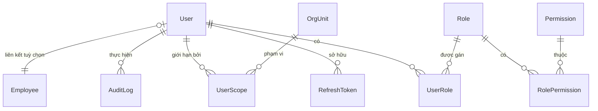
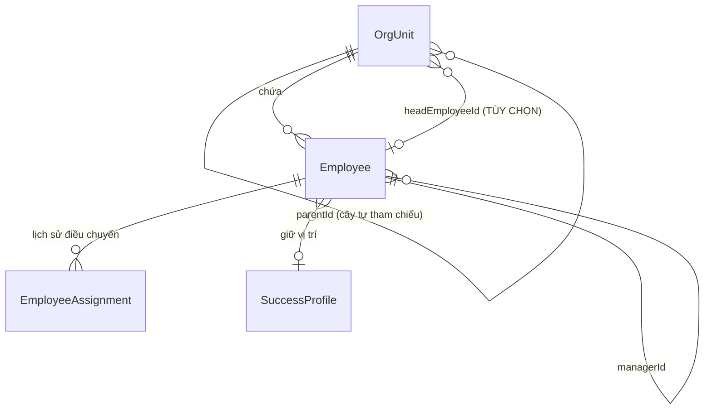
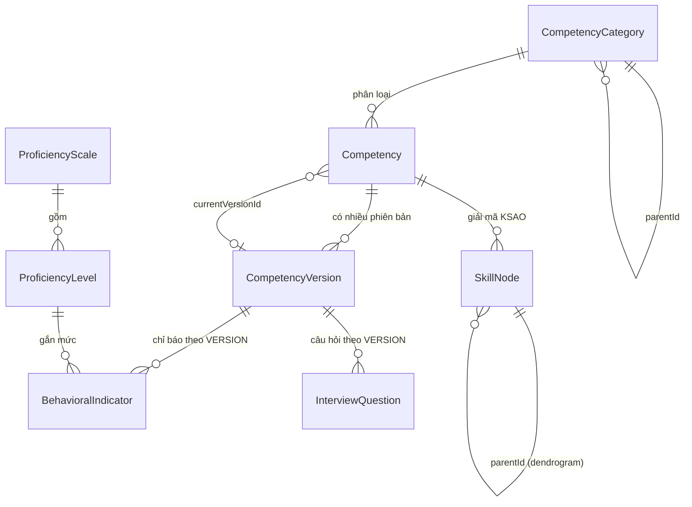
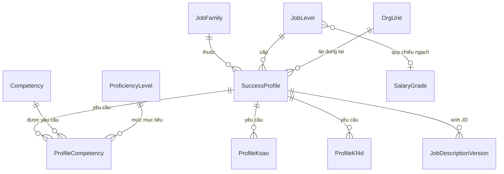
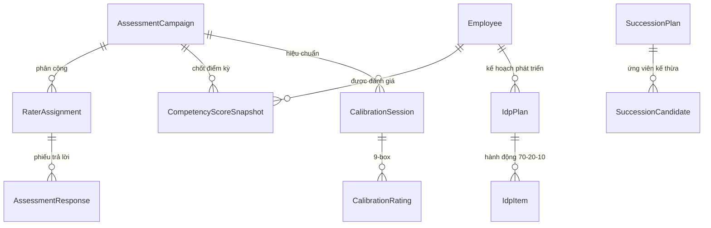

# CompetencyAI — Tài liệu Kiến trúc (GĐ0)

> **Trạng thái:** GĐ0 hoàn tất — chờ nghiệm thu trước khi sang GĐ1.
> Theo đúng hướng dẫn A.3: *làm theo giai đoạn, dừng và nghiệm thu, đừng để AI làm một mạch cả sản phẩm.*

---

## 1. Phạm vi GĐ0

| Hạng mục | Trạng thái |
|---|---|
| Lược đồ Prisma đầy đủ (40 model, 14 enum) | Xong |
| ERD theo miền | Xong |
| Chốt enum, quan hệ, index | Xong |
| Kiểm tra 118 quan hệ có chiều ngược khớp | Đạt |
| `prisma validate` bằng CLI thật | **Chưa chạy được** — xem mục 6 |

---

## 2. Kiến trúc tổng thể

```
competencyai/                    (npm workspaces monorepo)
├── apps/
│   ├── web/                     Next.js 14 App Router + TS + Tailwind
│   └── api/                     NestJS REST + Swagger (/api/docs)
├── packages/
│   └── db/                      Prisma schema + client + seed
├── docker-compose.yml           Postgres + api + web + Caddy
└── docs/
    └── ARCHITECTURE.md
```

**Luồng phụ thuộc:** `web → api → db`. Web không bao giờ gọi thẳng Prisma.

**Nguồn chân lý:** `packages/db/prisma/schema.prisma`. Mọi thay đổi schema bắt buộc kèm 3 việc — cập nhật DTO backend, cập nhật type frontend, bổ sung chuỗi i18n VI/EN (theo B.9).

---

## 3. ERD theo miền

### 3.1 Xác thực & Phân quyền



### 3.2 Tổ chức & Nhân sự



### 3.3 Từ điển năng lực (trục versioning)



### 3.4 Kiến trúc nghề → Hồ sơ năng lực



### 3.5 Đánh giá → Nhân tài



---

## 4. Cách 8 Nguyên tắc B.5 được hiện thực hoá trong schema

| # | Nguyên tắc | Hiện thực hoá |
|---|---|---|
| 1 | Khoá ngoại ID thật | Mọi quan hệ dùng `@relation(fields: [xxxId], references: [id])`. Không có field nào liên kết bằng tên. |
| 2 | Cây tổ chức linh hoạt | `OrgUnit.parentId` tự tham chiếu + `tier Int`. `unitType` chỉ là **nhãn gợi ý**, không ràng buộc. Ràng buộc `child.tier > parent.tier` cài ở service + DB trigger trong migration. |
| 3 | Thang cấu hình được | `ProficiencyScale.levelCount` + `ProficiencyLevel.label Json`. Mặc định 4 mức Korn Ferry qua `isDefault`. |
| 4 | Versioning từ điển | `Competency` (ổn định) tách khỏi `CompetencyVersion` (nội dung). `BehavioralIndicator` và `InterviewQuestion` gắn vào **versionId**, không gắn vào competencyId. `currentVersionId` là con trỏ. |
| 5 | Điểm không ghi đè | `CompetencyScoreSnapshot` khoá duy nhất theo `(campaignId, employeeId, competencyId)` — mỗi kỳ một bản chụp riêng. `CalibrationRating` cũng theo session. |
| 6 | RBAC + scope + audit | `Role`/`Permission`/`RolePermission` + `UserScope(orgUnitId, includeDescendants)` + `AuditLog(before, after)`. |
| 7 | Trưởng đơn vị tuỳ chọn | `OrgUnit.headEmployeeId String?` với `onDelete: SetNull`. Khuyết → UI hiển thị "Chưa bổ nhiệm". |
| 8 | Nhiều khung song song | `FrameworkType` enum trên cả `CompetencyCategory` và `Competency`. `CompetencyRole` phân vai trò khi dựng hồ sơ. |

---

## 5. Quyết định thiết kế đáng chú ý

**`onDelete` chọn có chủ đích, không để mặc định.**
`Cascade` cho dữ liệu con thuộc sở hữu (version → indicator). `Restrict` cho dữ liệu tham chiếu chuẩn (competency đang dùng trong profile thì không xoá được). `SetNull` cho quan hệ tuỳ chọn (trưởng đơn vị nghỉ việc thì đơn vị vẫn tồn tại).

**`isManagerial` lưu trong DB thay vì tính động.**
B.7 nói *"isManagerial tự suy từ Career Level"*. Tôi vẫn lưu cột này để index và query nhanh, nhưng giá trị do service tính khi ghi — không cho client tự đặt.

**`LocalizedText` là `Json` chứ không phải bảng riêng.**
Chỉ 2 ngôn ngữ, luôn đọc cùng lúc với bản ghi cha. Tách bảng sẽ tạo N+1 query mà không được lợi gì.

**`EmployeeAssignment` tách khỏi `Employee`.**
Employee giữ vị trí *hiện tại*; bảng assignment giữ *lịch sử*. Cùng tinh thần với nguyên tắc 5 — không ghi đè quá khứ.

---

## 6. Điều chưa xác minh được — cần bạn chạy khi nghiệm thu

`prisma validate` và `prisma generate` **chưa chạy được trong môi trường này** vì không tải được engine binary của Prisma (mạng bị giới hạn domain).

Đã kiểm tra thay thế bằng script: **118/118 field quan hệ đều có chiều ngược khớp tên** — đây là loại lỗi phổ biến nhất khi viết schema Prisma thủ công. Nhưng vẫn còn các lỗi khác chỉ CLI mới bắt được (cú pháp attribute, kiểu index không hợp lệ).

Lệnh cần chạy đầu tiên khi bạn nhận file:

```bash
npx prisma validate
npx prisma migrate dev --name init
npx prisma generate
```

Nếu có lỗi, sửa rồi mới sang GĐ1.

---

## 7. Nghiệm thu GĐ0 (theo B.10)

- [ ] `prisma validate` trả về hợp lệ
- [ ] `prisma migrate dev` tạo được migration trên Postgres 15+
- [ ] Kiểm tra ràng buộc `child.tier > parent.tier` đã được thêm vào migration
- [ ] Rà soát 8 nguyên tắc B.5 với schema (dùng bảng ở mục 4)
- [ ] Commit Git mốc `phase-0-schema`

---

## 8. Việc của GĐ1 (chưa làm)

Đăng nhập JWT access + refresh, guard RBAC toàn cục, `ScopeService` phân giải phạm vi theo persona, CRUD cây tổ chức với ràng buộc tier, hiển thị cây pre-order, bổ nhiệm trưởng đơn vị, seed dữ liệu mẫu idempotent.
